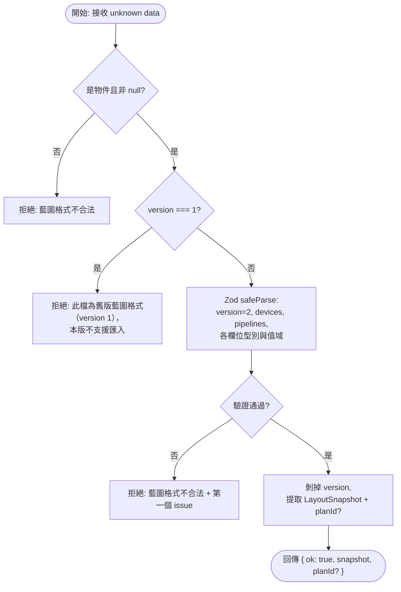

# Blueprint JSON 匯出／匯入純函式（blueprintFile）實作記錄

| 項目 | 內容 |
|------|------|
| 工單代號 | [W1109-Z1](../work_dispatch/azure9572/1109/W1109-Z1_blueprint_slice.md) |
| 對應規格 | [D4 最小藍圖 JSON 匯出／匯入（D4_blueprint_json_io.md）](../roadmap/detail/D4_blueprint_json_io.md) §4.1、§4.3、§4.6、§4.7 |
| 主責人員 | azure9572 |
| 交付檔案 | `src/types/blueprint.ts`<br>`src/utils/layout/blueprintFile.ts`<br>`src/__tests__/utils/layout/blueprintFile.test.ts`<br>`package.json`（新增 `zod` 依賴） |

---

## 1. 背景與目標

會議（2026-11-08）把 JSON 匯入匯出移出 POC 驗收，定位為**加分切片**（不影響 11/29 門檻）。Store 已經有 `layoutStore.toSnapshot()` 與 `layoutStore.loadSnapshot(snapshot)`，缺的是**檔案外殼**：匯出時在 `LayoutSnapshot` 外面包上 `version: 2`（及選擇性的 `planId`），匯入時驗證 JSON 形狀，通過後剝掉外殼交給既有的 `loadSnapshot`。

本任務目標為以 ≤2h 最小切片交付兩個純函式（`serializeBlueprint`、`parseBlueprint`）及 24 組單元測試。**不做**頂欄按鈕、不改 Navbar、不改 store 簽名。

---

## 2. 參考檔案與系統架構

| 檔案路徑 | 作用與參考內容 |
|----------|----------------|
| `src/types/layout.ts` | 核心型別定義：`LayoutSnapshot`、`PlacedDevice`、`Pipeline`、`LayoutIssues`、`Rotation`（由 `editor.ts` 匯入）。 |
| `src/types/euclideanSpace.ts` | 格子座標 `Position { x, y, z }`。 |
| `src/types/editor.ts` | `Rotation = 0 | 1 | 2 | 3`。 |
| `src/types/machine.ts` | `PortMedia = 'belt' | 'pipe'`。 |
| `src/types/plan.ts` | `Plan.id: string`（`planId` 來源型別參考）。 |
| `src/store/layoutStore.ts` | `toSnapshot(): LayoutSnapshot`（深拷貝匯出）、`loadSnapshot(snapshot): LayoutIssues`（覆寫佈局並進歷史）。 |
| `src/data/mockLayout.ts` | 預覽 fixture：`getMockLayoutScenario`、`toLayoutSnapshot` — 測試用設備與管線資料參考。 |
| `docs/roadmap/detail/D4_blueprint_json_io.md` | 完整技術決策：schema 凍結（§4.1）、版本跳 2（§4.2）、不讀舊檔（§4.3）、沿用 `loadSnapshot`（§4.4）、全有或全無（§4.5）、兩道驗證（§4.6）、Zod 已核准（§4.7）。 |

---

## 3. 使用的資料結構

### 3.1 佈局快照（LayoutSnapshot）

由 `src/types/layout.ts` 定義，為純資料物件（非 Pinia state）：

```typescript
interface LayoutSnapshot {
    devices: PlacedDevice[];
    pipelines: Pipeline[];
}
```

### 3.2 已放置設備（PlacedDevice）

```typescript
interface PlacedDevice {
    id: string;                   // 實例 uid
    machineType: string;          // 機器定義 id（snake_case）
    position: Position;           // { x, y, z }  佔格左上角
    rotation: Rotation;           // 0 | 1 | 2 | 3
    machineMode?: string;         // 機器型態 id；缺省 = modes[0]
    label?: string;               // 顯示用標籤
    recipeIndex?: number;         // 配方索引（除錯用）
    environment?: string;         // 節點環境標籤
    primaryOutput?: string;       // Source 產出品項
    sourceRatePerMin?: number;    // Source 產出速率（個/分）
}
```

**必要欄位**：`id`、`machineType`、`position`、`rotation`。其餘皆為選擇性。

### 3.3 管線（Pipeline）

```typescript
interface Pipeline {
    id: string;             // 管線 uid
    media: PortMedia;       // 'belt' | 'pipe'
    waypoints: Position[];  // 格子座標路徑：起點→彎折→終點（≥2 點）
}
```

### 3.4 藍圖檔案格式（BlueprintFile）— 本次新建

依 D4 §4.1 凍結的最小格式（佈局模型版）：

```typescript
interface BlueprintFile {
    version: 2;             // 格式版本；固定字面量 2
    planId?: string;        // 所屬計畫 UUID；省略時 JSON 中不出現
    devices: PlacedDevice[];
    pipelines: Pipeline[];
}
```

**本質**：`BlueprintFile = { version: 2, planId?: string } & LayoutSnapshot`。去掉 `version` 和 `planId` 就是一個可直接交給 `loadSnapshot` 的 `LayoutSnapshot`。

---

## 4. 演算法與判定邏輯

### 4.1 匯出：serializeBlueprint

```
輸入：LayoutSnapshot + planId?: string
輸出：BlueprintFile
```

**步驟**：
1. 接收 `snapshot: LayoutSnapshot`（呼叫方應使用 `layoutStore.toSnapshot()` 取得，該函式已深拷貝）。
2. 在最前面加上 `version: 2`。
3. 若有 `planId` 則帶上，沒有則不出現在物件中（`JSON.stringify` 自動忽略 `undefined`）。
4. `devices` 和 `pipelines` 直接展開自 snapshot（不需再深拷貝）。

**不做深拷貝的理由**：`toSnapshot()` 已做過深拷貝，本函式只加外殼欄位。

### 4.2 匯入：parseBlueprint（第一道：形狀驗證）

```
輸入：unknown（JSON.parse 的結果）
輸出：{ ok: true, snapshot: LayoutSnapshot, planId?: string }
      | { ok: false, error: string }
```

**步驟**：

1. **先攔 version 1**（D4 §4.3 專用提示）：
   - 若輸入為物件且 `version === 1`，直接回傳 `{ ok: false, error: '此檔為舊版藍圖格式（version 1），本版不支援匯入。' }`。
   - 此步驟在 Zod 驗證**之前**，確保 version 1 得到的是人類友善的專用訊息，而不是 Zod 的技術性錯誤。

2. **Zod 形狀驗證**：
   - 以 `blueprintSchema.safeParse(data)` 執行。
   - 驗證項目包含：`version` 必須是字面量 `2`、`devices` 為陣列且每個元素有必要欄位與正確型別、`pipelines` 為陣列且 `waypoints.length ≥ 2`、`media` 為 `'belt'` 或 `'pipe'`、`rotation` 為 `0|1|2|3`。
   - 失敗時取 Zod 第一個 issue，轉為可讀中文訊息回傳。

3. **剝掉 version，產出 LayoutSnapshot**：
   - 通過驗證後，拆出 `{ devices, pipelines }` 組成 `LayoutSnapshot`。
   - 若有 `planId` 一併回傳。

### 4.3 兩道驗證架構（D4 §4.6）

| 道 | 誰 | 查什麼 | 失敗怎麼辦 |
|----|-----|--------|-----------| 
| 1 | `parseBlueprint`（本項） | **形狀**：版本號、必要欄位、值域 | 拒絕整檔，畫布不動 |
| 2 | `loadSnapshot` 回傳的 `LayoutIssues`（既有） | **語意**：未知機型、佔格重疊、重複 id | `!ok` 時 undo 該筆 Macro 並拒絕 |

**本切片只做第一道**。第二道由呼叫方串接 `loadSnapshot`，不在本次範圍。

### 4.4 邏輯流程圖



---

## 5. 做的假設與邊界決策 (Assumptions & Decisions)

1. **版本 1 專用提示優先於 Zod**：
   若同時有 `version: 1` 和其他欄位錯誤，使用者只會看到「舊版格式」的提示。理由是版本不對時其他欄位的錯誤沒有意義，且 D4 §4.3 明確要求提示文字。

2. **Zod 只管形狀，不管語意**（D4 §4.7）：
   不把「機型是否存在」放進 schema（那需要讀機器資料表，會讓純函式失去可測性）。語意檢查完全交給 `loadSnapshot` 回傳的 `LayoutIssues`。

3. **schema 為型別唯一來源**（D4 §4.7）：
   `BlueprintFile` 以 `z.infer<typeof blueprintSchema>` 導出，不另寫 `interface`。避免 `PlacedDevice` 加欄位時 schema 與型別默默漂移。

4. **不深拷貝 serializeBlueprint 輸入**：
   呼叫方使用 `toSnapshot()` 取得已深拷貝的 snapshot，本函式不需再做一次。

5. **planId 由外部傳入**：
   `serializeBlueprint` 的第二參數為可選 string，不自動抓目前選中的 plan。切片範圍不涉及 plan 狀態管理。

6. **不安裝 Zod 以外的新依賴**：
   D4 §5 明確寫「只加這一個，不順手升級其他套件」。

---

## 6. 程式碼實作說明

### 6.1 Zod Schema — `src/types/blueprint.ts`

以 Zod 宣告子 schema 再組合為頂層 `blueprintSchema`：

```typescript
import { z } from 'zod';

const positionSchema = z.object({ x: z.number(), y: z.number(), z: z.number() });
const rotationSchema = z.union([z.literal(0), z.literal(1), z.literal(2), z.literal(3)]);
const portMediaSchema = z.union([z.literal('belt'), z.literal('pipe')]);

const placedDeviceSchema = z.object({
    id: z.string().min(1),
    machineType: z.string().min(1),
    position: positionSchema,
    rotation: rotationSchema,
    machineMode: z.string().optional(),
    label: z.string().optional(),
    recipeIndex: z.number().optional(),
    environment: z.string().optional(),
    primaryOutput: z.string().optional(),
    sourceRatePerMin: z.number().optional(),
});

const pipelineSchema = z.object({
    id: z.string().min(1),
    media: portMediaSchema,
    waypoints: z.array(positionSchema).min(2),
});

export const blueprintSchema = z.object({
    version: z.literal(2),
    planId: z.string().optional(),
    devices: z.array(placedDeviceSchema),
    pipelines: z.array(pipelineSchema),
});

export type BlueprintFile = z.infer<typeof blueprintSchema>;
```

### 6.2 純函式 — `src/utils/layout/blueprintFile.ts`

```typescript
import type { LayoutSnapshot } from '@/types/layout';
import { blueprintSchema, type BlueprintFile } from '@/types/blueprint';

export function serializeBlueprint(
    snapshot: LayoutSnapshot,
    planId?: string,
): BlueprintFile {
    return {
        version: 2,
        ...(planId !== undefined ? { planId } : {}),
        devices: snapshot.devices,
        pipelines: snapshot.pipelines,
    };
}

export type ParseBlueprintResult =
    | { ok: true; snapshot: LayoutSnapshot; planId?: string }
    | { ok: false; error: string };

export function parseBlueprint(data: unknown): ParseBlueprintResult {
    // 先攔 version 1（專用提示）
    if (
        typeof data === 'object' && data !== null &&
        'version' in data &&
        (data as Record<string, unknown>).version === 1
    ) {
        return { ok: false, error: '此檔為舊版藍圖格式（version 1），本版不支援匯入。' };
    }

    const result = blueprintSchema.safeParse(data);
    if (!result.success) {
        const issue = result.error.issues[0];
        const path = issue.path.length > 0 ? ` (${issue.path.join('.')})` : '';
        return { ok: false, error: `藍圖格式不合法${path}：${issue.message}` };
    }

    const { version: _, planId, devices, pipelines } = result.data;
    return {
        ok: true,
        snapshot: { devices, pipelines },
        ...(planId !== undefined ? { planId } : {}),
    };
}
```

### 設計特點

1. **純函式架構**：不依賴任何外部可變狀態，不匯入 Pinia Store 或 Vue Reactivity。多次執行相同輸入保證產生一致輸出。
2. **schema 與型別同源**：`BlueprintFile` 由 `z.infer` 推導，不手寫第二份 `interface`，避免 `PlacedDevice` 加欄位時漂移。
3. **version 1 專用攔截**：在 Zod 之前先處理，確保使用者得到明確的「舊版格式」提示而非技術性 Zod 錯誤訊息。
4. **安全容錯**：對 `null`、原始型別、陣列等非物件輸入，Zod 均能安全處理並回傳結構化錯誤。

---

## 7. 單元測試設計

檔案路徑：`src/__tests__/utils/layout/blueprintFile.test.ts`

共 24 項測試案例，涵蓋 round-trip、匯出細節、版本拒絕、欄位錯誤、非物件輸入：

| 編號 | 測試案例說明 | 預期結果 | 狀態 |
|------|-------------|---------|------|
| **T1** | 最小 snapshot：序列化再解析等值 | `ok: true`，snapshot 深度相等 | ✅ 通過 |
| **T2** | 完整欄位 snapshot：round-trip 保留所有選擇性欄位 | `ok: true`，所有欄位保留 | ✅ 通過 |
| **T3** | 空 snapshot（無設備無管線）：round-trip 通過 | `ok: true` | ✅ 通過 |
| **T4** | 帶 planId 的 round-trip | `ok: true`，`planId` 相符 | ✅ 通過 |
| **T5** | 不帶 planId 時結果也無 planId | `ok: true`，無 `planId` 屬性 | ✅ 通過 |
| **T6** | 輸出包含 `version: 2` | `file.version === 2` | ✅ 通過 |
| **T7** | 不帶 planId 時 JSON 中無此 key | `'planId' in file === false` | ✅ 通過 |
| **T8** | 帶 planId 時 JSON 中有此 key | `file.planId === 'my-plan'` | ✅ 通過 |
| **T9** | version 1 → 專用提示文字（含「舊版」與「version 1」） | `ok: false`，error 含關鍵字 | ✅ 通過 |
| **T10** | version 3（未知版本）→ 拒絕 | `ok: false` | ✅ 通過 |
| **T11** | 缺 version → 拒絕 | `ok: false` | ✅ 通過 |
| **T12** | 缺 devices → 拒絕 | `ok: false` | ✅ 通過 |
| **T13** | 缺 pipelines → 拒絕 | `ok: false` | ✅ 通過 |
| **T14** | devices 元素缺 machineType → 拒絕 | `ok: false` | ✅ 通過 |
| **T15** | devices 元素 id 為空字串 → 拒絕 | `ok: false` | ✅ 通過 |
| **T16** | rotation 為 5（不合法值）→ 拒絕 | `ok: false` | ✅ 通過 |
| **T17** | waypoints 只有 1 點 → 拒絕 | `ok: false` | ✅ 通過 |
| **T18** | media 為 `'steam'`（不合法值）→ 拒絕 | `ok: false` | ✅ 通過 |
| **T19** | 輸入 `null` → 拒絕 | `ok: false` | ✅ 通過 |
| **T20** | 輸入 `undefined` → 拒絕 | `ok: false` | ✅ 通過 |
| **T21** | 輸入 `42`（數字）→ 拒絕 | `ok: false` | ✅ 通過 |
| **T22** | 輸入 `'hello'`（字串）→ 拒絕 | `ok: false` | ✅ 通過 |
| **T23** | 輸入 `true`（布林）→ 拒絕 | `ok: false` | ✅ 通過 |
| **T24** | 輸入 `[1, 2, 3]`（陣列）→ 拒絕 | `ok: false` | ✅ 通過 |

---

## 8. 新增依賴

| 套件 | 版本 | 用途 | 核准依據 |
|------|------|------|---------|
| `zod` | 4.6.7 | 藍圖 JSON 形狀驗證、型別推導 | D4 §4.7（2026-09-20 主編核准，PR [#51](https://github.com/dernoson/endfield-playground/pull/51)） |

未安裝其他依賴，未升級既有套件。

---

## 9. 不做（本切片範圍外）

- ❌ 頂欄 Save／Load 按鈕（D4 §6 的 11/22 切片，非本任務）
- ❌ 改 `Navbar.vue`
- ❌ 接到右側面板或畫布
- ❌ 讀 v1 舊檔（D4 §4.3 決議：不轉換）
- ❌ 第二道語意驗證串接（由呼叫方 `loadSnapshot` + `LayoutIssues` 負責）
- ❌ 連線合法性驗證 `canConnect`（D4 §4.6.1，依賴 C2）
- ❌ 改 `layoutStore` 或 `editorStore` 任何簽名

---

## 10. 驗收核對（DoD Checklist）

- [x] `serializeBlueprint` 純函式完成：`LayoutSnapshot` → `BlueprintFile`（`version: 2`）。
- [x] `parseBlueprint` 純函式完成：`unknown` → 驗證通過回 `LayoutSnapshot`，失敗回錯誤。
- [x] `BlueprintFile` 由 `z.infer<typeof blueprintSchema>` 導出，非手寫 interface（D4 §4.7）。
- [x] Zod 只管形狀，不管語意（機型不在 schema 中驗證）。
- [x] `version: 1` 被拒絕，提示文字為 D4 §4.3 規定的原文。
- [x] 24 組單元測試全數通過（round-trip、拒絕、邊界）。
- [x] `pnpm type-check` 通過（0 錯誤）。
- [x] 未修改 `layoutStore` / `editorStore` 任何簽名。
- [x] 未碰 `Navbar.vue`、頂欄、右側面板。
- [x] 新增依賴僅 `zod`，未升級其他套件。
