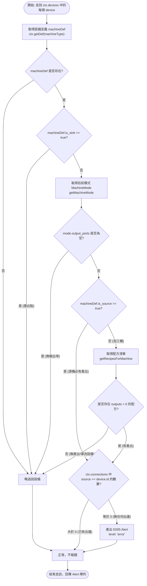

# E005 缺少輸出偵測器（E005_missingOutput）實作記錄

| 項目 | 內容 |
|------|------|
| 工單代號 | [W1026-Z0](../work_dispatch/azure9572/1026/W1026-Z0_pause.md) 自願最小切片、[W1004-Z1](../work_dispatch/azure9572/1004/W1004-Z1_recipe_alerts_new_model.md) |
| 對應規格 | [D3 配方類警訊 (D3_recipe_alerts.md)](../roadmap/detail/D3_recipe_alerts.md) §4.1、§4.3、[spec/09_recipe_warning.md](../../spec/09_recipe_warning.md) |
| 主責人員 | azure9572 |
| 交付檔案 | `src/lib/validation/detectors/E005_missingOutput.ts`<br>`src/__tests__/lib/validation/detectors/E005_missingOutput.test.ts`<br>`src/app/dev/ValidationTest.vue`（註冊與測試鈕） |

---

## 1. 背景與目標

在 CR-09「配方警示」與 R-D3 的規劃中，配方類警示共凍結三組代碼：
- **`E004`**：缺少必要輸入（已於 PR #64 合入 master）。
- **`E005`**：缺少輸出連接（本項目標）。
- **`W001`**：材料組合無法處理（已於 PR #35 與 #64 合入 master）。

設備若產生輸出（例如採礦機採集礦石，或加工機配方產出產物），但**未接出任何輸送帶／管線**，產物將無處可去。依據 `spec/09_recipe_warning.md`，此現象屬於 **Error 等級**（阻斷後續 CR-04 流量估算）。

在 8 月份的舊分支 `dev/azure9572` 上曾有早期草稿，但因專案歷經 V7～V17 架構收斂（包含多模式 `MachineMode`、機型以英文 ID 查定義、配方改以中文名查詢、新增 `is_sink` 匯出點標記等），舊版代碼存在嚴重 API 分歧。

本任務目標為以 **master 現行新模型**（`src/types/validation.ts` 的 `Detector` / `ValidationContext`）為準，以 ≤2h 最小切片獨立交付純函式偵測器 `E005_missingOutput`、12 組完備單元測試，並於開發驗證頁面完成註冊。

---

## 2. 參考檔案與系統架構

| 檔案路徑 | 作用與參考內容 |
|----------|----------------|
| `src/types/validation.ts` | 核心型別定義：`Detector`、`ValidationContext`、`Alert`、`AlertLevel`。 |
| `src/types/machine.ts` | 機器靜態結構定義：`Machine`、`MachineMode`、`PortDef` 與輔助函式 `getMachineMode`。 |
| `src/types/graph.ts` | 藍圖圖結構型別：`FactoryNode`（設備節點）、`FactoryEdge`（管線邊）。 |
| `src/types/flow.ts` | 配方型別定義：`RecipeDef`、`RecipeItem`。 |
| `src/data/products.ts` | 配方靜態查詢：`getRecipesForMachine(machineName, modeId)`。 |
| `src/lib/validation/detectors/E004_missingInput.ts` | 對偶偵測器參考（對稱的篩選條件、入邊/出邊判定）。 |
| `src/app/dev/l1ContractLab/contractCatalog.ts` | V17 契約：機型走 `ctx.getDef`，配方鍵走 `def.name`。 |
| `src/app/dev/ValidationTest.vue` | 驗證系統測試頁：透過 `validationStore.registerDetector` 掛載並呈現警示。 |

---

## 3. 使用的資料結構

### 3.1 驗證上下文（ValidationContext）
由 composable（`useValidation.buildContext()`）組裝後傳入純函式：
- `devices: FactoryNode[]`：畫布上所有已擺放的節點清單。節點資料 `node.data` 包含 `machineType`（設備 ID 或名稱）、`machineMode`（運作模式 id）、`recipeIndex`。空間座標已轉為格子座標。
- `connections: FactoryEdge[]`：畫布上所有連線邊。每條連線包含 `source`（來源節點 id）、`target`（目標節點 id）。
- `getDef(machineType: string): Machine | undefined`：由外部注入之設備定義快查函式（對接 `resolveMachineDef`，支援英文 ID 優先退回中文名稱）。

### 3.2 機器與模式定義（Machine & MachineMode）
- `Machine.is_sink: boolean`：是否為物品輸入口（產線終點，產值計算的 sink），本來就沒有出邊。
- `Machine.is_source: boolean`：是否為基礎材料輸出點／採礦機（產線起點），天生有產出。
- `Machine.modes: MachineMode[]`：設備支援的運作型態列表。
- `MachineMode.output_ports: readonly PortDef[]`：該型態擁有的輸出埠列表。

### 3.3 警示資料結構（Alert）
依 CR-03 規範，每個警示產出必填 6 個欄位：
```typescript
interface Alert {
  uid: string;                    // 唯一識別碼，使用 crypto.randomUUID()
  level: 'error';                 // 警示等級，E005 為 'error'
  code: 'E005';                   // 警示代碼
  message: string;                // 人類可讀訊息，如 "缺少輸出：精煉爐 有產出但未連接任何輸出管線"
  relatedDeviceUids: string[];    // 關聯設備 uid 列表（填入 device.id）
  relatedConnectionUids: string[];// 關聯管線 uid 列表（E005 為 []）
}
```

---

## 4. 演算法與判定邏輯

### 4.1 核心規則（D3 §4.3 & spec/09）
- **判定條件**：該設備有產出（源類機器、或當前 mode 存在會產生輸出的配方），但畫布上**沒有任何管線從此設備接出**（`connections.some(c => c.source === device.id)` 為 `false`）。
- **排除條件**：
  1. `is_sink: true` 的匯出點（如「物品輸入口」）。
  2. 該模式下無輸出埠（`output_ports.length === 0`）之設備。
  3. 該模式下無任何會產生輸出的配方（例如分流器無配方，或無輸出特殊模式）。
  4. 查無設備定義之未知節點。

### 4.2 邏輯流程圖



---

## 5. 做的假設與邊界決策 (Assumptions & Decisions)

1. **匯出點（`is_sink: true`）永不報 E005**：
   產線終點（例如「物品輸入口」）其規格就是只進不出，如果沒有接出管線是完全正常的設計，因此第一優先跳過。
2. **源類機器（`is_source: true`）直接判定為有產出**：
   採礦機、基礎材料輸出點、物品輸出口天生是材料供給端（品項由其本身或 `primaryOutput` 指定，不一定在 `products.json` 有傳統合成配方）。只要其具備輸出埠且未接出邊，即屬於輸出缺失。
3. **導流設備（分流器、匯流器、物流橋）不獨立觸發 E005**：
   導流設備在 `products.json` 中查無配方（`recipes` 為空），因此在未連接任何管線時不會誤觸 E005，符合「無產出設備不套用」之規格。
4. **配方查詢必須傳入中文名**：
   對齊 V17 契約，`getRecipesForMachine` 一律以 `machineDef.name` 查詢，避免因傳入英文 ID 查不到配方導致漏報。
5. **Phase 1 採用設備層級判定**：
   只要該設備有任何一條輸出邊（`source === device.id`），即視為已接出輸出管線；多輸出埠各自是否塞滿則留待後續流量模擬與進階檢查。

---

## 6. 程式碼實作說明

檔案路徑：`src/lib/validation/detectors/E005_missingOutput.ts`

```typescript
import type { Alert, Detector, ValidationContext } from '@/types/validation';
import { getRecipesForMachine } from '@/data/products';
import { getMachineMode } from '@/types/machine';

export const E005_missingOutput: Detector = {
    code: 'E005',
    level: 'error',
    run(ctx: ValidationContext): Alert[] {
        const alerts: Alert[] = [];

        for (const device of ctx.devices) {
            const machineType = device.data?.machineType ?? device.data?.label ?? device.id;
            const machineDef = ctx.getDef(machineType);

            // 若查無設備定義，或是匯出點（is_sink: true），不套用 E005
            if (!machineDef || machineDef.is_sink) {
                continue;
            }

            const mode = getMachineMode(machineDef, device.data?.machineMode);
            // 若該型態沒有任何輸出埠，略過
            if (!mode || mode.output_ports.length === 0) {
                continue;
            }

            // 判斷該機是否有產出：
            // 1. 若為源類機器（is_source: true），天生負責提供產出
            // 2. 若為一般加工機，檢查目前 mode 下是否存在會產生輸出的配方
            const recipes = getRecipesForMachine(machineDef.name, mode.id);
            const hasRecipeWithOutput = recipes.some((recipe) => (recipe.outputs?.length ?? 0) > 0);
            const hasOutput = machineDef.is_source || hasRecipeWithOutput;
            if (!hasOutput) {
                continue;
            }

            // 檢查是否有任何從此設備接出的管線（出邊）
            const outEdges = ctx.connections.filter((c) => c.source === device.id);
            if (outEdges.length === 0) {
                alerts.push({
                    uid: crypto.randomUUID(),
                    code: 'E005',
                    level: 'error',
                    message: `缺少輸出：${machineDef.name} 有產出但未連接任何輸出管線`,
                    relatedDeviceUids: [device.id],
                    relatedConnectionUids: [],
                });
            }
        }

        return alerts;
    },
};
```

---

## 7. 單元測試規劃

檔案路徑：`src/__tests__/lib/validation/detectors/E005_missingOutput.test.ts`

共規劃 12 項測試案例，全面涵蓋各種邊界條件：
- **T1**：無設備時不應產生錯誤。
- **T2**：匯出點（`is_sink: true`）即使無出邊也不觸發 E005。
- **T3**：加工機已有出邊連接，不觸發 E005。
- **T4**：需產出材料的加工機無任何出邊，觸發 E005（驗證 code、level、message、relatedDeviceUids、uid）。
- **T5**：設備無輸出埠時不觸發 E005。
- **T6**：設備無產出配方（例如分流器或無產出加工機）時不觸發 E005。
- **T7**：源機（`is_source: true`）無任何出邊，觸發 E005。
- **T8**：源機（`is_source: true`）已有出邊連接，不觸發 E005。
- **T9**：多設備場景下僅未連接出邊的產出設備報 E005。
- **T10**：查無定義之未知設備不報錯。
- **T11**：依據 `machineMode` 判定配方產出需求（`craft_mode` 有產出報錯，`idle_mode` 無產出不報錯）。
- **T12（V17 契約）**：英文 id 加工機（如 `processor_a`）無出邊可正確解析並報 E005。

---

## 8. Dev 測試頁面整合

檔案路徑：`src/app/dev/ValidationTest.vue`

1. 匯入並掛載偵測器：
   ```typescript
   import { E005_missingOutput } from '@/lib/validation/detectors/E005_missingOutput';
   // ...
   validationStore.registerDetector(E005_missingOutput);
   ```
2. 新增純粹觸發 E005 的測試按鈕：
   ```html
   <button
       @click="testPlaceUnconnectedSource"
       class="w-full rounded-md bg-rose-600 px-3 py-2 text-sm text-white hover:bg-rose-700"
   >
       ➕ 新增沒接輸出線的源機（採礦機 @60,20，純粹觸發 E005）
   </button>
   ```
3. 新增測試行為：放置一台 `採礦機`（源機 `is_source: true` 不觸發 E004，但無出邊而觸發 E005），使用者可獨立觀測到 1 筆純粹的 E005 錯誤。

---

## 9. 驗收核對（DoD Checklist）

- [x] `E005_missingOutput.ts` 純函式完成，無 Vue / Pinia 依賴。
- [x] 未修改 `ValidationContext` 簽名，未碰 `layoutStore` / `editorStore`，未碰 `LayoutView`。
- [x] 遵守 V17 契約：透過 `ctx.getDef` 查機型，透過 `machineDef.name` 查配方。
- [x] 12 組單元測試撰寫完成。
- [x] 開發驗證頁面完成註冊與測試按鈕更新。
